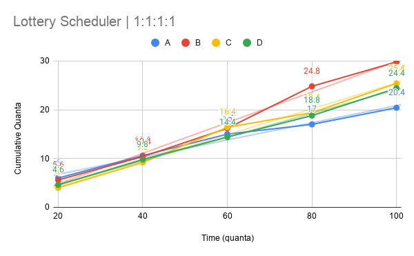
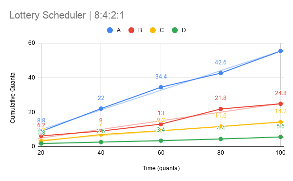
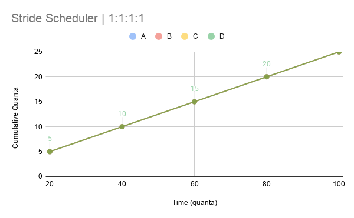
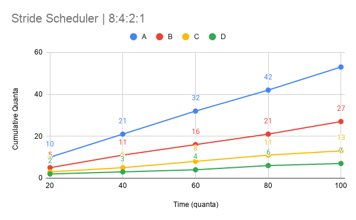

# Lab 1 Report - 10/3/26
### CSEN 383
### Zachary Common and Calianna Collins
### https://github.com/Eval427/xv6-riscv
#### https://youtu.be/-iB0XIucjic

## Modified files
```m
\ = Modified
+ = Added
- = Removed

\ Makefile

\ kernel/defs.h
\ kernel/proc.c
\ kernel/proc.h
\ kernel/syscall.c
\ kernel/syscall.h
\ kernel/sysproc.c

+ user/lab2test.c
+ user/sched_tickets.c
\ user/user.h
\ user/usys.pl
```

## Part 1
Part 1 includes the addition of two new syscalls: `sched_statistics(void)` and `sched_tickets(int)`

### Process Changes
The first necessary change to the codebase is the introduction of the necessary parameters to allow for lottery and stride scheduling. For lottery scheduling, each process needs to store its `tickets`. For stride scheduling, each process needs a `pass` and `stride`. Additionally, `ticks` was included in order to track the number of times a process is chosen in any scheduler.

```c
// Per-process state
struct proc {
  struct spinlock lock;

  // p->lock must be held when using these:
  enum procstate state;        // Process state
  void *chan;                  // If non-zero, sleeping on chan
  int killed;                  // If non-zero, have been killed
  int xstate;                  // Exit status to be returned to parent's wait
  int pid;                     // Process ID

  // wait_lock must be held when using this:
  struct proc *parent;         // Parent process

  // these are private to the process, so p->lock need not be held.
  uint64 kstack;               // Virtual address of kernel stack
  uint64 sz;                   // Size of process memory (bytes)
  pagetable_t pagetable;       // User page table
  struct trapframe *trapframe; // data page for trampoline.S
  struct context context;      // swtch() here to run process
  struct file *ofile[NOFILE];  // Open files
  struct inode *cwd;           // Current directory
  char name[16];               // Process name (debugging)
  int syscall_count;           // Total number of system calls that the current process has made
  int tickets; /*<--*/         // Number of tickets for the lottery scheduling process
  int ticks;   /*<--*/         // Number of times this process was called (chosen) by scheduler
  int pass;    /*<--*/
  int stride;  /*<--*/
};
```

Furthermore, since each process needs to be given some number of tickets in order to be picked in the scheduler, `allocproc()` was adjusted to give each process a base number of 100 tickets and to initialize the stride, pass, and ticks.

```c
static struct proc*
allocproc(void)
{
  struct proc *p;
  uint64 K = 10000; // <--

  for(p = proc; p < &proc[NPROC]; p++) {
    acquire(&p->lock);
    if(p->state == UNUSED) {
      goto found;
    } else {
      release(&p->lock);
    }
  }
  return 0;

found:
  p->pid = allocpid();
  p->state = USED;
  p->tickets = 100; // Need at least one ticket to run at all
  p->syscall_count = 0;
  p->stride = K / p->tickets; // <--
  p->pass = p->stride; // <--
  p->ticks = 0; // <--
  ...
}
```

### `sched_statistics(void)`
The implementation of `sched_statistics(void)` follows all other standard procedures for syscall implementations. For any process that calls it, it will print the number of `tickets` and number of `ticks` that process has.

```c
// kernel/proc.c

int sched_statistics(void) {
  struct proc *p;
  
  for (p = proc; p < &proc[NPROC]; p++) {
    if (p->state < 2) continue;
    acquire(&p->lock);
    int pid = p->pid;
    char *name = p->name;
    int tickets = p->tickets;
    int ticks = p->ticks;
    release(&p->lock);

    printf("%d(%s): tickets: %d, ticks: %d\n", pid, name, tickets, ticks);
  }

  return 0;
}
```

```c
// kernel/defs.h:115

int sched_statistics(void); // sched_statistics
```

```c
// kernel/syscall.c:115 & 145

extern uint64 sys_sched_statistics(void);
...
[SYS_sched_statistics] sys_sched_statistics, //sched_statistics: syscall entry
```

```c
// kernel/syscall.h:27

#define SYS_sched_statistics 26 // sched_statistics
```

```c
// kernel/sysproc.c

uint64 sys_sched_statistics(void) {
  // name of process
  sched_statistics();
  return 0;
}
```

```c
// user/user.h:30

int sched_statistics(void); // sched_statistics
```

```pl
# user/usys.pl:43

entry("sched_statistics"); # sched_statistics syscall for user
```

### `sched_tickets(int)`
The implementation of `sched_tickets(int)` allows for a process to set the number of `tickets` it has, which influences both the lottery and stride scheduling policies. A main file was included for this syscall to test it via the command line (excluded from report since it is not necessary).

```c
// kernel/proc.c

void set_proc_tickets(int tickets) {
  struct proc *currProc = myproc();
  int K = 10000;

  if (!currProc) {
    printf("Unable to get current process in set_proc_tickets()\n");
    return;
  }

  currProc->tickets = tickets;
  currProc->stride = K / currProc->tickets;
  currProc->pass = currProc->stride;
  //printf("DEBUG - Successfully set tickets to %d\n", tickets);
}
```

```c
// kernel/defs.h:114

void set_proc_tickets(int); // sched_tickets
```

```c
// kernel/syscall.c:114 & 144

extern uint64 sys_sched_statistics(void);
...
[SYS_sched_tickets] sys_sched_tickets, // sched_tickets: syscall entry

```c
// kernel/syscall.h:26

#define SYS_sched_tickets 25 // sched_tickets
```

```c
// kernel/sysproc.c

uint64 sys_sched_tickets(void) {
  int param;
  argint(0, &param);

  if (param <= 10000) {
    set_proc_tickets(param);
  } else {
    printf("The number of tickets for each process cannot exceed 10,000\n");
  }

  return 0;
}
```

```c
// user/user.h:29

int sched_tickets(int); // sched_tickets
```

```pl
# user/usys.pl

entry("sched_tickets"); # sched_tickets syscall for user
```

## Part 2
Part 2 implements two new scheduling policies, `lottery` and `stride`, alongside the standard xv6 round robin scheduler. While both schedulers follow similar implementations and utilize the same `ticket` currency, `lottery` is a non-deterministic, fair scheduler due to its use of randomness while `stride` is deterministic and fair. Note that all implementations for the new schedulers were done in `scheduler.c`

### Lottery Scheduler
The first requirement for the lottery scheduler is a random number generator. Based on the lab documentation alongside some modifications to make the overall implementation more straightforward, a pseudo-random number generator was implemented.

```c
// kernel/scheduler.c

// Pseudo-rand number generator (adjusted to use uint32)
uint32 lfsr = 0xACE1u;
uint32 rand() {
    uint32 bit;
    bit = ((lfsr >> 0) ^ (lfsr >> 10) ^ (lfsr >> 30) ^ (lfsr >> 31)) & 1;
    return lfsr = (lfsr >> 1) | (bit << 31);
}
```

The lottery scheduler implementation then works as follows:
1. Iterate through the list of processes and add the tickets of any `RUNNABLE` process to `total_tix`
1. If `total_tix` is 0, then there are no processes that can run and the cpu sleeps
1. Generate the winning ticket number by calling `rand() % total_tix`
1. Loop through the list of `RUNNABLE` processes until reaching the winning ticket
1. The context of the cpu switches to the new process and that process gets to execute

```c
// kernel/scheduler.c

// Lottery scheduler
void lottery() {
  struct proc *p;
  struct cpu *c = mycpu();

  c->proc = 0;

  // Iterate through all runnable procs to gather total tickets
  uint64 total_tix = 0;
  for (p = proc; p < &proc[NPROC]; p++) {
    acquire(&p->lock);
    if (p->state == RUNNABLE && p->tickets > 0) total_tix += p->tickets;
    release(&p->lock);
  }

  if (total_tix == 0) {
    // No processes with tickets exist - stop running core
    intr_on();
    asm volatile("wfi");
    return;
  }

  uint64 winning_ticket = rand() % total_tix;
  uint64 parsed_tix = 0;

  // Iterate again to determine which proc won
  for (p = proc; p < &proc[NPROC]; p++) {
    acquire(&p->lock);
      if (p->state == RUNNABLE && p->tickets > 0) {
        parsed_tix += p->tickets;

        // When the # of parsed tickets overtakes the winner, that proc is selected
        if (winning_ticket < parsed_tix) {
          p->state = RUNNING;
          p->ticks += 1;
          c->proc = p;
          swtch(&c->context, &p->context);

          c->proc = 0;
          release(&p->lock);
          break;
        }
      }
    release(&p->lock);
  }
}
```

### Stride Scheduler
The stride scheduler also takes advantage of the `tickets` from the lottery scheduler. However, instead of using a random number generator to pick the winning process, it instead chooses the process with the lowest `pass`. The logic for managing and choosing processes in the stride policy is as follows:

1. By default, each process' `pass` starts at 0 and `stride` is calculated as `K` / `tickets` where `K` is some large constant
   - For this implementation, `K` = 10,000
1. When the scheduler must make a decision, it first iterates through all `RUNNABLE` processes and saves the process with the lowest `pass` in `winner`
   - In the case of a tie, the `RUNNABLE` process in the last slot of the proc array is chosen
1. Once the `winner` is chosen, the cpu switches context to that process and it gets to execute
1. The `pass` of the process is incremented by its `stride`, ensuring that processes with more `tickets` are able to execute more frequently since their `pass` increases at a slower rate

```c
// kernel/scheduler.c

// Stride scheduler
void stride() {
  struct proc *p;
  struct cpu *c = mycpu();
  
  c->proc = 0;

  // Iterate through all runnable procs to gather total processes, set pass values if unset
  uint64 total_procs = 0;
  struct proc *winner = proc;
  for (p = proc; p < &proc[NPROC]; p++) {
    acquire(&p->lock);
    if (p->state == RUNNABLE && p->tickets > 0) { 
      total_procs += 1;
      if (winner->pass > p->pass) winner = p;
    }
    release(&p->lock);
  }
   
  if (total_procs == 0) {
    // No processes with tickets exist - stop running core
    intr_on();
    asm volatile("wfi");
    return;
  }

  // Switch context to winner (last element in the case of a tie)
  acquire(&winner->lock);
  winner->state = RUNNING;
  winner->ticks += 1;
  winner->pass += winner->stride;
  c->proc = winner;
  swtch(&c->context, &winner->context);

  c->proc = 0;
  release(&winner->lock);
}
```

## Part 3
The results gathered from our xv6 scheduling policies is shown below. Note that each experiment shows numbers that are the average of 5 iterations.

The lottery policy, while fair over long periods of time, is non-deterministic. As a result, during our tests, the lottery scheduler often strayed aray from the ideal allocation. This is especially prominent in the 1:1:1:1 lottery scheduler. Idealy, each process should be completely equal. However, especially at high time, there is significant variance in the amount of CPU time each process gets.

Our results prove that the stride policy is deterministic while remaining fair. The stride policy represents an idealized version of the lottery scheduler. It eliminates the problematic deviance from the ideal allocation that the lottery policy saw at higher times while maintaining fairness.

### Lottery Scheduler with 1:1:1:1 Tickets per Process


### Lottery Scheduler with 8:4:2:1 Tickets Per Process


### Stride Scheduler with 1:1:1:1 Tickets per Process


### Stride Scheduler with 8:4:2:1 Tickets per Process
